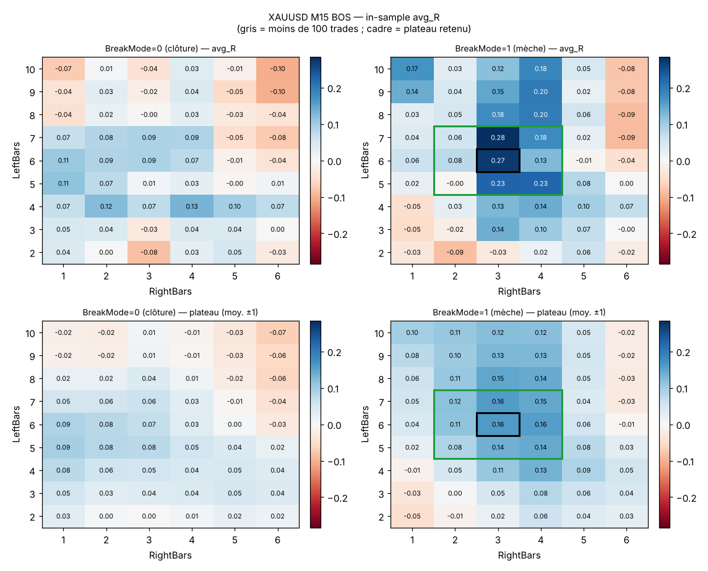
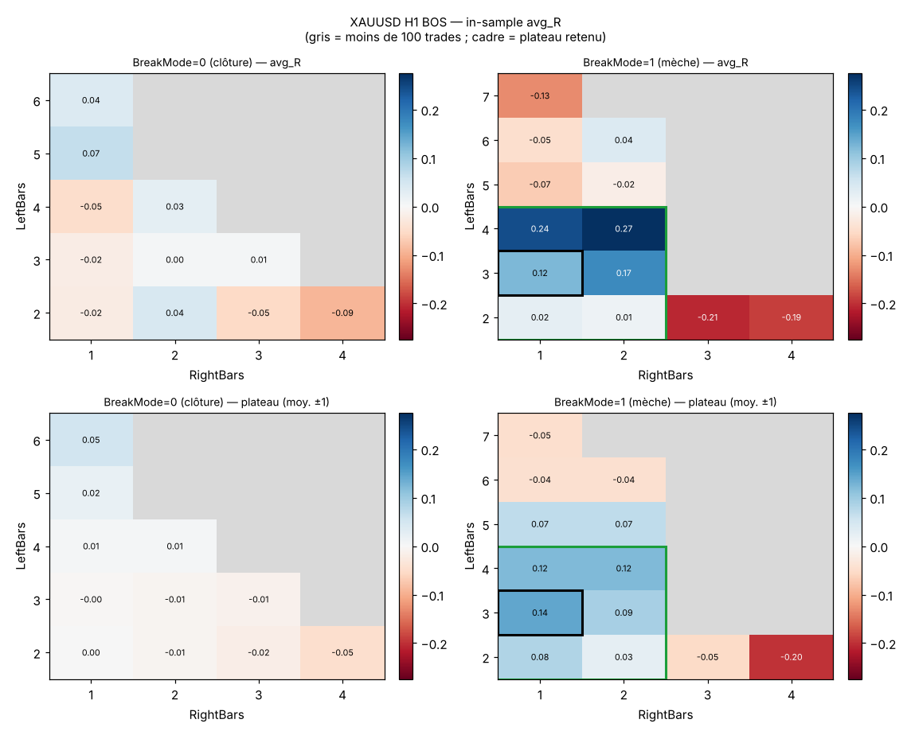
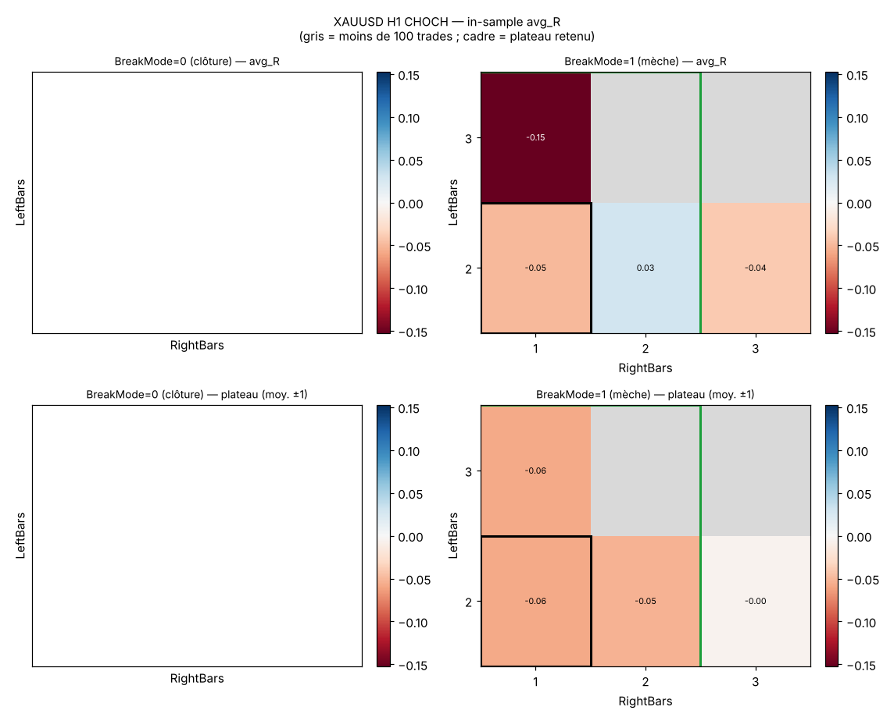

# Rapport Module 1 — Structure (BOS / CHOCH)

Généré le 2026-11-05 14:14 par `analyse/analyse_module1.py` à partir de **3 fichier(s) CSV** dans `resultats/module1`. Début du forward : 2025-07-01. Tous les chiffres proviennent des CSV de l'EA (coûts du testeur inclus) ; rien n'est extrapolé.

## 1. Verdict par symbole × UT

| Symbole | UT | Verdict | Détail | avg_R IS | trades | avg_R OOS | p aléa |
|---|---|---|---|---|---|---|---|
| XAUUSD | M15 | **À CONFIRMER** | BOS : À CONFIRMER (L6 R3 B1) | 0.271 | 275 | — | — |
| XAUUSD | H1 | **À CONFIRMER** | BOS : À CONFIRMER (L3 R1 B1) / CHOCH : PAS D'EDGE (L2 R1 B1) | 0.123 | 118 | — | — |


Détail des conditions : `synthese_verdicts.csv`.

## 2. Règles de verdict (appliquées automatiquement)

Les verdicts sont calculés pour chaque symbole × UT × type d'événement, sur le
**plateau retenu** en in-sample (IS). Une cellule de grille n'est valide que si elle a
**≥ 100 trades**. Le « plateau » d'une cellule = moyenne de avg_R sur la cellule et ses
voisines LeftBars ±1 / RightBars ±1 (même BreakMode). On retient la cellule dont le plateau
est le plus élevé (parmi celles dont ≥ 75% du voisinage est valide), **jamais le pic isolé** :
le tri se fait d'abord sur « ≥ 70% de voisins positifs », puis sur la moyenne du voisinage
**sans sa meilleure valeur** (un pic isolé ne peut donc pas tirer ses voisins), puis sur la moyenne.

Conditions :
- **C0 Échantillon** : au moins une cellule IS avec ≥ 100 trades.
- **C1 Plateau positif** : plateau > 0, avg_R de la cellule centrale > 0, et ≥ 70% des
  cellules voisines valides ont avg_R > 0.
- **C2 Significativité IS** : t-stat approx. ≥ 2.0 (avg_R × √trades / σ estimé), **ou**
  borne basse de l'IC 95 % bootstrap > 0 si le CSV des trades de ce réglage est fourni.
- **C3 Forward (OOS)** : même réglage sur la période forward avec ≥ 40 trades et avg_R > 0
  (lu dans le CSV d'optimisation forward, à défaut dans la partie OOS du CSV de trades).
- **C4 Contrôle aléatoire** : avg_R réel supérieur à au moins 95 % des runs aléatoires
  (p empirique ≤ 0.05) ; si moins de 5 runs aléatoires : z ≥ 1,96.

Verdict :
- **EDGE PROBABLE** : C0, C1, C2, C3 et C4 tous vrais (et grille testée en real ticks).
- **PAS D'EDGE** : C0 faux (échantillon insuffisant), ou C1 faux, ou C3 évalué et faux
  (OOS ≥ 40 trades avec avg_R ≤ 0), ou C4 évalué avec p > 0.2.
- **À CONFIRMER** : tous les autres cas (C1 vrai mais C2, C3 ou C4 manquant ou non atteint
  sans être réfuté ; ou grille en « 1 minute OHLC » à reconfirmer en real ticks).

Le verdict symbole × UT = meilleur verdict entre BOS et CHOCH (détail affiché).

## 3. Fichiers lus et avertissements

| fichier | type | lignes |
|---|---|---|
| PA_M1_opt_XAUUSD_H1_20261105_1122.csv | optimisation | 108 |
| PA_M1_opt_XAUUSD_H1_20261105_1244.csv | optimisation | 108 |
| PA_M1_opt_XAUUSD_M15_20261105_1347.csv | optimisation | 108 |

## 4. Détail par symbole × UT × événement

### XAUUSD M15 — BOS (RR=3, SLBuffer=0.10 ATR)

Passes in-sample : 108, dont 108 avec ≥ 100 trades.

**Top 10 (classement par score = avg_R × √trades)**

| L | R | B | trades | winrate | avg_R | score | t_approx | PF_R | DD_R |
|---|---|---|---|---|---|---|---|---|---|
| 7 | 3 | 1 | 260 | 0.323 | 0.283 | 4.571 | 2.426 | 1.411 | 26.669 |
| 6 | 3 | 1 | 275 | 0.320 | 0.271 | 4.494 | 2.392 | 1.391 | 23.666 |
| 5 | 3 | 1 | 291 | 0.309 | 0.227 | 3.864 | 2.068 | 1.320 | 23.341 |
| 5 | 4 | 1 | 283 | 0.307 | 0.225 | 3.788 | 2.033 | 1.320 | 19.393 |
| 8 | 4 | 1 | 238 | 0.302 | 0.198 | 3.058 | 1.649 | 1.278 | 16.506 |
| 9 | 4 | 1 | 224 | 0.304 | 0.200 | 2.992 | 1.616 | 1.281 | 15.445 |
| 7 | 4 | 1 | 248 | 0.298 | 0.182 | 2.860 | 1.548 | 1.253 | 19.593 |
| 8 | 3 | 1 | 263 | 0.297 | 0.176 | 2.853 | 1.549 | 1.245 | 26.667 |
| 10 | 4 | 1 | 220 | 0.300 | 0.185 | 2.744 | 1.485 | 1.258 | 14.286 |
| 3 | 3 | 1 | 376 | 0.290 | 0.139 | 2.703 | 1.482 | 1.191 | 19.877 |

**Plateau retenu** : LeftBars=6, RightBars=3, BreakMode=1 → plateau 0.160 R, moyenne tronquée 0.145 R, cellule 0.271 R, 275 trades, t≈2.39, voisins positifs 89 %.

Pic brut (meilleur score) : L=7 R=3 B=1, avg_R 0.283, plateau autour 0.157 → pic isolé, écarté.

Meilleur plateau par BreakMode : B0 = 0.094 R, B1 = 0.160 R



**Forward / out-of-sample**

_Pas de données forward pour ce réglage._

**Contrôle aléatoire**

_Pas de contrôle aléatoire fourni (prompt modèle CONTROLE_ALEATOIRE)._

**Verdict : À CONFIRMER** — C3 manquant (forward); C4 manquant (contrôle aléatoire)

### XAUUSD H1 — BOS (RR=3, SLBuffer=0.10 ATR)

Passes in-sample : 108, dont 24 avec ≥ 100 trades.

**Top 10 (classement par score = avg_R × √trades)**

| L | R | B | trades | winrate | avg_R | score | t_approx | PF_R | DD_R |
|---|---|---|---|---|---|---|---|---|---|
| 4 | 2 | 1 | 110 | 0.327 | 0.274 | 2.877 | 1.553 | 1.401 | 11.123 |
| 4 | 1 | 1 | 120 | 0.317 | 0.243 | 2.664 | 1.444 | 1.351 | 14.275 |
| 3 | 2 | 1 | 106 | 0.302 | 0.174 | 1.788 | 0.985 | 1.244 | 14.298 |
| 3 | 1 | 1 | 118 | 0.288 | 0.123 | 1.337 | 0.744 | 1.170 | 21.629 |
| 5 | 1 | 0 | 104 | 0.269 | 0.066 | 0.668 | 0.375 | 1.088 | 17.342 |
| 2 | 2 | 0 | 123 | 0.268 | 0.044 | 0.484 | 0.277 | 1.059 | 15.194 |
| 6 | 1 | 0 | 106 | 0.264 | 0.038 | 0.396 | 0.223 | 1.051 | 21.216 |
| 6 | 2 | 1 | 101 | 0.267 | 0.038 | 0.386 | 0.222 | 1.052 | 14.165 |
| 2 | 1 | 1 | 153 | 0.261 | 0.025 | 0.303 | 0.174 | 1.033 | 17.243 |
| 4 | 2 | 0 | 102 | 0.265 | 0.026 | 0.265 | 0.153 | 1.035 | 15.298 |

**Plateau retenu** : LeftBars=3, RightBars=1, BreakMode=1 → plateau 0.142 R, moyenne tronquée 0.116 R, cellule 0.123 R, 118 trades, t≈0.74, voisins positifs 100 %.

Pic brut (meilleur score) : L=4 R=2 B=1, avg_R 0.274, plateau autour 0.121 → pic isolé, écarté.

Meilleur plateau par BreakMode : B0 = 0.052 R, B1 = 0.142 R



**Forward / out-of-sample**

_Pas de données forward pour ce réglage._

**Contrôle aléatoire**

_Pas de contrôle aléatoire fourni (prompt modèle CONTROLE_ALEATOIRE)._

**Verdict : À CONFIRMER** — C2 non atteint (t≈0.74); C3 manquant (forward); C4 manquant (contrôle aléatoire)

### XAUUSD H1 — CHOCH (RR=3, SLBuffer=0.10 ATR)

Passes in-sample : 108, dont 4 avec ≥ 100 trades.

**Top 10 (classement par score = avg_R × √trades)**

| L | R | B | trades | winrate | avg_R | score | t_approx | PF_R | DD_R |
|---|---|---|---|---|---|---|---|---|---|
| 2 | 2 | 1 | 110 | 0.264 | 0.029 | 0.308 | 0.177 | 1.040 | 22.680 |
| 2 | 3 | 1 | 103 | 0.243 | -0.039 | -0.400 | -0.232 | 0.949 | 26.841 |
| 2 | 1 | 1 | 133 | 0.241 | -0.050 | -0.573 | -0.333 | 0.936 | 27.476 |
| 3 | 1 | 1 | 112 | 0.214 | -0.152 | -1.611 | -0.977 | 0.809 | 34.808 |

**Plateau retenu** : LeftBars=2, RightBars=1, BreakMode=1 → plateau -0.058 R, moyenne tronquée -0.101 R, cellule -0.050 R, 133 trades, t≈-0.33, voisins positifs 33 %.

Pic brut (meilleur score) : L=2 R=2 B=1, avg_R 0.029, plateau autour -0.053 → non retenu, plateau voisin plus stable.

Meilleur plateau par BreakMode : B0 = — R, B1 = -0.005 R



**Forward / out-of-sample**

_Pas de données forward pour ce réglage._

**Contrôle aléatoire**

_Pas de contrôle aléatoire fourni (prompt modèle CONTROLE_ALEATOIRE)._

**Verdict : PAS D'EDGE** — C1 faux (plateau -0.058, cellule -0.050, voisins + 33 %); C2 non atteint (t≈-0.33); C3 manquant (forward); C4 manquant (contrôle aléatoire)

## 5. Analyse des journaux de trades

_Aucun CSV de trades fourni (prompt modèle RUN_TRADES)._

## 6. Suggestions pour l'itération 2

| Symbole | UT | Événement | Verdict | LeftBars | RightBars | BreakMode | RR |
|---|---|---|---|---|---|---|---|
| XAUUSD | M15 | BOS | À CONFIRMER | 4..8 | 1..5 | 1..1 | garder 3.0 |
| XAUUSD | H1 | BOS | À CONFIRMER | 1..5 | 1..3 | 1..1 | garder 3.0 |


Règle : plateau retenu ±2 sur LeftBars et RightBars (±3 côté bord de grille si le plateau touche le bord) ; BreakMode fixé si l'autre mode a un plateau inférieur d'au moins 0,05 R. Les combinaisons « PAS D'EDGE » sont abandonnées. Ne pas re-tester sur la période forward pour choisir : elle reste réservée à la validation.

Bloc à coller dans `module1/generer_prompts.py` (avec `ITERATION = 2`) :

```python
PLAGES_SPECIFIQUES = {
    ("XAUUSD", "M15", 0): {"InpLeftBars": (4, 1, 8), "InpRightBars": (1, 1, 5), "InpBreakMode": (1, 1, 1)},
    ("XAUUSD", "H1", 0): {"InpLeftBars": (1, 1, 5), "InpRightBars": (1, 1, 3), "InpBreakMode": (1, 1, 1)},
}
COMBINAISONS = [
    ("XAUUSD", "M15", 0),
    ("XAUUSD", "H1", 0),
]
```

## 7. Prochaines étapes

- XAUUSD M15 BOS : run forward, contrôle aléatoire (L6 R3 B1), run simple trades (L6 R3 B1)
- XAUUSD H1 BOS : run forward, contrôle aléatoire (L3 R1 B1), run simple trades (L3 R1 B1)

## 8. Réglages retenus par UT

Aucun réglage universel : chaque ligne est choisie **uniquement** à partir des passes in-sample de ce symbole × UT × événement (plateau retenu, §2). Aucun « meilleur réglage global » toutes UT confondues n'est calculé.

| Symbole | UT | Événement | LeftBars | RightBars | BreakMode | trades | avg_R IS | avg_R forward | Verdict |
|---|---|---|---|---|---|---|---|---|---|
| XAUUSD | M15 | BOS | 6 | 3 | 1 | 275 | 0.271 | — | À CONFIRMER |
| XAUUSD | H1 | BOS | 3 | 1 | 1 | 118 | 0.123 | — | À CONFIRMER |
| XAUUSD | H1 | CHOCH | 2 | 1 | 1 | 133 | -0.050 | — | PAS D'EDGE |


(« — » = pas de réglage retenu : échantillon insuffisant. Un réglage « PAS D'EDGE » est listé pour mémoire, il n'est pas recommandé.)


_STOP : validation du trader requise avant l'itération suivante._
